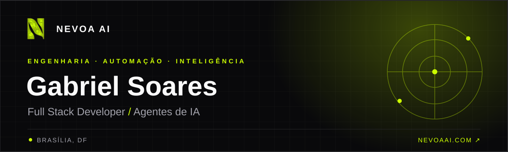

<div align="center">

<a href="https://nevoaai.com/"></a>

<br>

<a href="https://nevoaai.com/"></a>
<a href="https://www.linkedin.com/in/gabrielsoaresss/"></a>

**Código próprio. Dados reais. Inteligência aplicada.**

</div>

## 01 / Sobre mim

Sou **Gabriel Soares**, desenvolvedor **full stack** e criador de **agentes de IA** na [Nevoa AI](https://nevoaai.com/), em Brasília. Gosto de transformar processos complexos em produtos claros: da interface e das APIs à integração de dados, automação e deploy.

Hoje, meu foco está em **agentes inteligentes**, **sistemas de atendimento**, **integrações sob medida** e experiências digitais que funcionam na operação real.

```text
gabriel@nevoa:~$ foco --atual
> Full stack · Agentes de IA · Automação · Integrações
```

## 02 / O que construo

| Área | Trabalho |
|:--|:--|
| **Agentes de IA** | Fluxos de atendimento e agentes conectados a dados e ferramentas. |
| **Desenvolvimento full stack** | Interfaces, serviços, APIs e experiências de ponta a ponta. |
| **Automação e integrações** | Sistemas que conversam entre si e reduzem trabalho manual. |

## 03 / Stack

<div align="center">


`Python` · `Node.js` · `React` · `Vue` · `Go` · `C#` · `APIs` · `IA`

</div>

## 04 / Em movimento

<div align="center">


</div>

## 05 / Vamos conversar

Trabalho na **[Nevoa AI](https://nevoaai.com/)**, onde criamos automação e IA sob medida para operações reais. Para acompanhar meu trabalho ou trocar uma ideia, [conecte-se comigo no LinkedIn](https://www.linkedin.com/in/gabrielsoaresss/).

<div align="center">

<sub>Gabriel Soares · Brasília, DF · Nevoa AI</sub>

</div>
